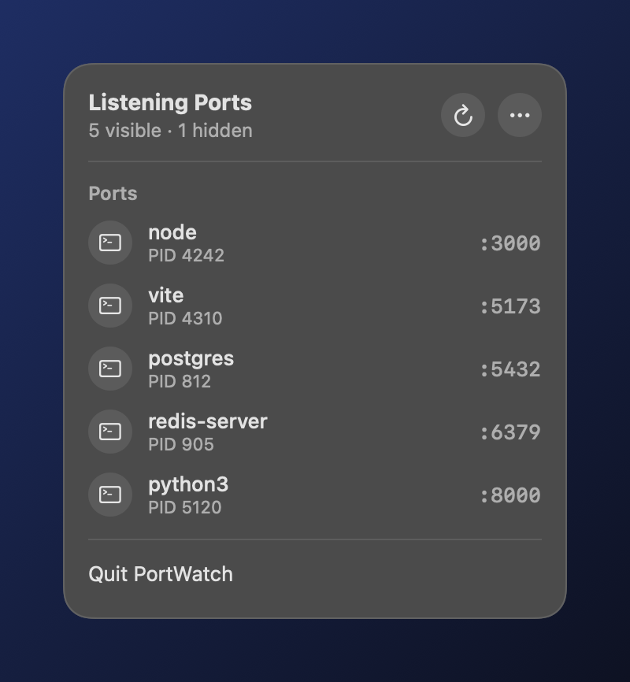

<p align="center"></p>

<h1 align="center">PortWatch</h1>

<p align="center">A lightweight macOS menu bar app that watches listening TCP ports.<br>
See what's running on <code>:3000</code>, hide the noise, kill what you don't need.</p>

<p align="center"></p>

## Features

- **Every listening TCP port** with its process name, PID and app icon
- **Hide** ports you don't care about. Hidden ports are remembered across launches and live in a separate Hidden section
- **Kill** the process behind a port with a two-click confirm (moving the mouse away cancels)
- **Auto refresh** every 3 seconds, or refresh on demand
- **Menu bar only**: no Dock icon, no Cmd-Tab entry
- **Liquid Glass app icon** with light, dark, clear and tinted variants

## Install

1. Download `PortWatch-1.0.0.dmg` from [Releases](https://github.com/hourmeng12/PortWatch/releases/latest).
2. Open it and drag **PortWatch** into **Applications**.
3. The app is not notarized, so the first launch needs one of these:
   - Right-click **PortWatch** → **Open** → **Open**, or
   - run `xattr -dr com.apple.quarantine /Applications/PortWatch.app`

Requires macOS 15 or later (Apple silicon and Intel).

## Usage

Click the socket icon in the menu bar to open the panel.

| Action | How |
|---|---|
| Hide or unhide a port | Hover the row, click the eye |
| Kill a process | Hover the row, click ✕, then **Kill** |
| Refresh now | Refresh button in the header, or ⌘R |
| Pause auto refresh | ··· menu → **Auto Refresh** |
| Show hidden ports | ··· menu → **Show Hidden Ports** |
| Close the panel | Click outside it, click the icon again, or press Esc |
| Quit | **Quit PortWatch**, or ⌘Q |

## Build from source

```bash
swift run                      # run the debug build
swift test                     # parser tests
scripts/release.sh 1.0.0       # dist/PortWatch.app, .dmg, .zip, SHA256SUMS.txt
```

The app icon lives in `Assets/AppIcon.icon` and can be edited in Icon Composer (ships with Xcode). `release.sh` compiles it with `actool`.

## Notes

PortWatch reads ports with `/usr/sbin/lsof`. Without root it may not see the PID of other users' processes, and it can only kill your own.
