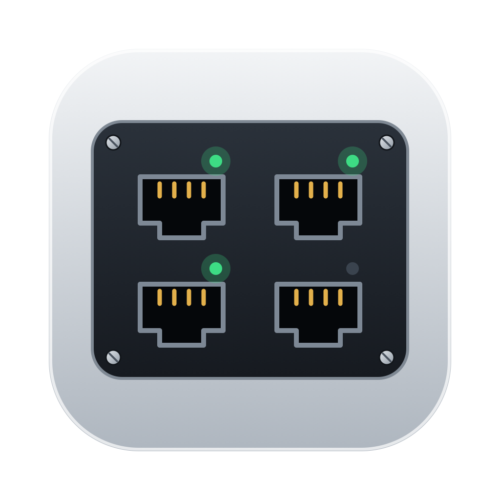

<p align="center"></p>

<h1 align="center">PortWatch</h1>

<p align="center">A lightweight macOS menu bar app that watches listening TCP ports.</p>

## Features

- Lists every listening TCP port with its process name, PID and app icon
- Hide ports you don't care about (remembered across launches), show them again any time
- Kill the process behind a port with a two-click confirm
- Auto refresh every 3 seconds, or refresh on demand (⌘R)
- Lives in the menu bar only: no Dock icon

## Install

1. Download `PortWatch-1.0.0.dmg` from [Releases](https://github.com/hourmeng12/PortWatch/releases).
2. Open it and drag **PortWatch** into **Applications**.
3. The app is not notarized, so the first launch needs one of these:
   - Right-click **PortWatch** → **Open** → **Open**, or
   - run `xattr -dr com.apple.quarantine /Applications/PortWatch.app`

Requires macOS 15 or later (Apple silicon and Intel).

## Build from source

```bash
swift run                      # run the debug build
swift test                     # parser tests
scripts/release.sh 1.0.0       # dist/PortWatch.app, .dmg, .zip, SHA256SUMS.txt
```

PortWatch reads ports with `/usr/sbin/lsof`. Without root it may not see the PID of other users' processes, and it can only kill your own.
